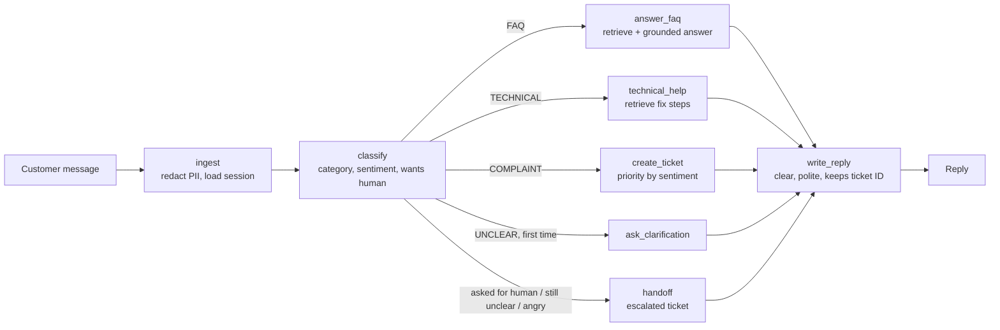

# AI Customer Support Agent

A production-style customer support agent built with **LangGraph**. It reads a
customer message, decides what kind of query it is, and then answers from the FAQ,
walks the customer through a fix, raises a ticket, asks a clarifying question, or
hands the conversation to a human.


It extends the prototype I worked on during my summer internship at BINMARK IT
Consultancy & Solutions into a service with an HTTP API, tests, an evaluation
harness, PII redaction, Docker and CI.

## Features

| Feature | What it does |
|---|---|
| Query classification | FAQ / TECHNICAL / COMPLAINT / UNCLEAR, via a few-shot LLM prompt or an offline rule-based classifier |
| Grounded FAQ answers (RAG) | Retrieves from `data/faq.md`; says "I don't have that information" instead of guessing |
| Troubleshooting | Retrieves step-by-step fixes from `data/troubleshooting.md`; raises a ticket if no guide matches |
| Ticketing | SQLite ticket store with priority (high when the customer is angry) |
| Clarification memory | Remembers per session that it asked a question and reads the answer with the original message |
| Human handoff | On request, when still unclear after one clarification, or when unclear and angry |
| PII redaction | Masks email, phone, card (Luhn-checked), PAN and Aadhaar before the LLM, logs or tickets see them |
| Resilience | LLM failures fall back to rules / the draft reply; the agent never crashes on a bad model answer |
| Evaluation | 40 labelled queries, accuracy, confusion matrix, precision/recall/F1, CI quality gate |
| Ops | FastAPI, JSON logs with request IDs, optional API key, Docker (non-root, healthcheck), GitHub Actions |

## Architecture



All nodes share one typed state (`SupportState`). A LangGraph checkpointer stores
that state per `session_id`, which is what lets the agent remember a clarifying
question between messages.

## Quick start

```bash
git clone https://github.com/<your-username>/ai-support-agent.git
cd ai-support-agent
python -m venv .venv && source .venv/bin/activate   # Windows: .venv\Scripts\activate
pip install -e ".[dev]"

make test        # 39 tests
make eval        # classification report
make chat        # talk to the agent in the terminal
make run         # API on http://localhost:8000  (docs at /docs)
```

It runs **with no API key** by default (offline mode). To use the LLM:

```bash
cp .env.example .env
# set SUPPORT_LLM_PROVIDER=openai and OPENAI_API_KEY=sk-...
```

With Docker: `docker compose up --build`.

## API

```bash
curl -X POST localhost:8000/v1/chat -H 'content-type: application/json' \
  -d '{"message": "pasword reset link is not wrking", "session_id": "user-42"}'
```

```json
{
  "session_id": "user-42",
  "reply": "Sorry you're having trouble. Please try these steps: ...",
  "category": "TECHNICAL",
  "route": "technical_help",
  "sentiment": "neutral",
  "ticket_id": null,
  "escalated": false,
  "pii_redacted": {},
  "sources": [{"id": "troubleshooting-2", "title": "Password reset link not working or not received", "score": 0.517}],
  "latency_ms": 13
}
```

| Method | Path | Purpose |
|---|---|---|
| POST | `/v1/chat` | Send a message, get the reply and routing details |
| GET | `/v1/tickets` | List recent tickets |
| GET | `/v1/tickets/{id}` | Fetch one ticket |
| GET | `/health` | Liveness check |

If `SUPPORT_API_KEY` is set, `/v1/*` endpoints require the `X-API-Key` header.

## Evaluation

`python -m support_agent.evaluation` runs `eval/queries.jsonl` (10 queries per
class, including typos, very short messages and queries that fit two types).

Offline rule-based classifier:

| Class | Precision | Recall | F1 |
|---|---|---|---|
| FAQ | 1.00 | 0.90 | 0.95 |
| TECHNICAL | 1.00 | 0.90 | 0.95 |
| COMPLAINT | 1.00 | 1.00 | 1.00 |
| UNCLEAR | 0.83 | 1.00 | 0.91 |
| **Accuracy** | | | **95% (38/40)** |

The two misses ("Is my data safe with you?", "my data is not syncing...") fall to
UNCLEAR, which is the safe failure: the agent asks a question instead of giving a
wrong answer. The test set was written alongside the rules, so treat this as a
development score; a fair benchmark needs held-out, real (anonymised) queries.
Run the same command with `SUPPORT_LLM_PROVIDER=openai` to score the LLM classifier.
CI fails the build if accuracy drops below 90%.

## Project structure

```
src/support_agent/
  graph.py          LangGraph workflow: nodes, routing, shared state
  agent.py          builds the agent from settings; handle(message, session_id)
  classifier.py     LLM + rule-based classifiers, label parsing, sentiment, handoff
  knowledge.py      Markdown loader + TF-IDF retrieval
  pii.py            PII redaction
  tickets.py        SQLite ticket store
  writer.py         final reply step with guardrails
  prompts.py        all prompts in one place
  llm.py            chat-model interface (OpenAI via LangChain)
  api.py            FastAPI service
  evaluation.py     metrics + CI quality gate
  config.py         settings from environment / .env
data/               FAQ and troubleshooting knowledge base (edit these, no code change)
eval/queries.jsonl  labelled evaluation set
tests/              unit, graph and API tests (an LLM fake makes them run offline)
```

## Design decisions

- **Rules and LLM behind one interface.** The keyword classifier keeps tests and CI
  free and deterministic, and it is the fallback when the LLM times out.
- **Parse, don't trust, LLM output.** The classifier scans the model's answer for a
  valid label and defaults to UNCLEAR, so a chatty answer never breaks routing.
- **UNCLEAR is the safe default.** A wrong guess gives a wrong answer; asking a
  question costs one extra message.
- **Redact at the entry point.** Nothing downstream (LLM, logs, tickets) sees raw
  personal data, in line with the DPDP Act, 2023.
- **Character n-gram TF-IDF for retrieval.** Fast, free and typo-tolerant for a
  knowledge base of this size; `KnowledgeBase` can be swapped for embeddings and a
  vector store without touching the graph.

## Roadmap

- Embedding retrieval (FAISS / pgvector) for larger knowledge bases
- Shared checkpointer (Postgres/Redis) so several API replicas share sessions
- Connectors for real ticket systems (Zendesk, Freshdesk, Jira)
- Hindi and other Indian languages; voice input
- Tracing with LangSmith or OpenTelemetry

## License

MIT
